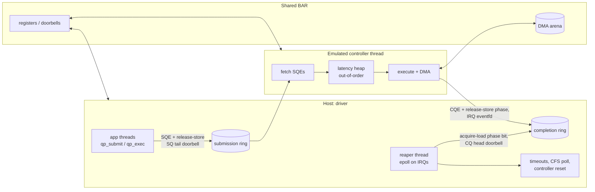

# qpair

[](https://github.com/rkhan28/qpair/actions/workflows/ci.yml)


An NVMe-style queue-pair driver in C11, written against an emulated DMA storage controller.

The point of the project is the hardware/software boundary: the driver knows the device only through a register map, doorbells, shared rings and interrupts, exactly as a real driver would, and the emulated device is hostile enough (reordering, losing, forging and wedging) to make the recovery paths earn their keep.

## Architecture



The only shared contract is [`include/qp_regs.h`](include/qp_regs.h): register offsets, doorbell layout, the 64-byte SQE and 16-byte CQE, and status codes. The driver never includes device internals and the device never includes driver internals.

## Features

**Driver** ([`src/driver.c`](src/driver.c))
- Multiple submission/completion queue pairs; doorbells on separate cache lines
- Phase-bit completions with acquire/release ordering on both sides
- Generation-tagged command IDs (`gen << 12 | slot`), so stale or forged completions are rejected instead of completing the wrong request
- Backpressure: a queue of depth `N` has `N-1` slots, so the ring can never overflow
- One reaper thread drains CQs, runs timeouts and polls `CSTS.CFS`
- Transient errors retried in place; permanent errors returned as errno
- Full controller reset: disable, wait `RDY=0`, zero rings, re-enable, re-post in-flight commands. Only commands that actually timed out are charged a retry
- A device that will not come back is marked dead and everything fails with `-EIO`
- Page-granular DMA arena allocator

**Emulated device** ([`src/device.c`](src/device.c))
- Runs on its own thread; touches memory only through the BAR and bounds-checks every IOVA against the arena
- Randomised latency with out-of-order completion (min-heap)
- Fault injection: transient errors, lost completions, hang, fatal status, forged completions, permanent death

## Build and test

```sh
make test     # 15 tests, a few seconds
make asan     # AddressSanitizer + UBSan + LeakSanitizer
make tsan     # ThreadSanitizer: checks the doorbell / phase-bit ordering
make bench    # ./build/bench [threads] [queues] [depth] [secs] [read%] [lat_us]
make check    # all of the above except bench
```

Requires Linux (eventfd, epoll, ppoll) and GCC or Clang.

## Results

Measured in a 2-vCPU sandbox with ~20 us simulated device latency, 4 KiB random I/O, 70% reads:

| threads | queues | queue depth | IOPS    | p50 (us) | p99 (us) |
|--------:|-------:|------------:|--------:|---------:|---------:|
| 1       | 1      | 64          | ~389 K  | 111      | 377      |
| 4       | 4      | 128         | ~489 K  | 392      | 1355     |

The 4-thread run has more runnable threads than cores (4 workers + device + reaper on 2 vCPUs), so its latency is mostly scheduling.

## Tests

| Area | What is checked |
|------|-----------------|
| Protocol | phase-bit wraparound on a depth-8 ring, out-of-order completion, backpressure bound |
| Contract | bad opcode / length / LBA / DMA address return the right errno and are not retried |
| Recovery | transient errors, lost completion, hung device, fatal status, dead device, forged completion, close with I/O in flight |
| Allocator | exhaustion, fragmentation, coalescing, double-free detection |
| Stress | 8 threads over 4 shared queues, per-thread shadow-copy verification, with and without injected faults |

See [DESIGN.md](DESIGN.md) for the reasoning behind the main decisions and how the sanitizer results were validated.

## Limitations

- A single reaper thread serialises completion callbacks. Fine at this rate; it would be sharded per queue to go higher.
- Device and driver share one address space so TSan can check the protocol. A separate-process variant (memfd + fd passing) would be more realistic but would give up that checking.
- Reads, writes and flush only; no admin queue, namespaces or scatter-gather lists.

## License

MIT. See [LICENSE](LICENSE).
